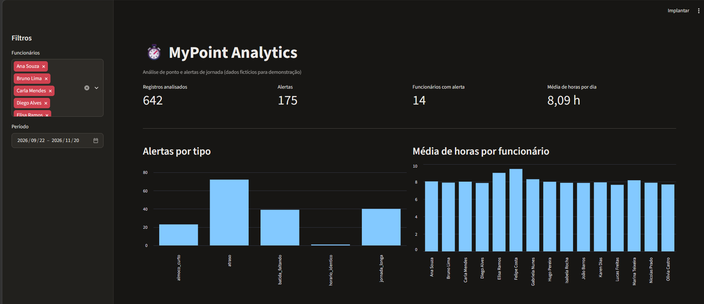
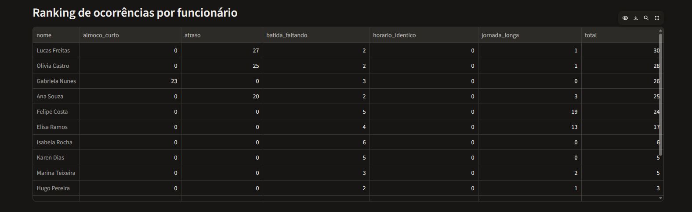

# MyPoint Analytics

Camada de análise em Python para um sistema de ponto eletrônico feito em Java (MyPointVirtual). Lê as batidas direto do banco MySQL, calcula as horas trabalhadas, detecta ocorrências de jornada e mostra tudo em um painel feito com Streamlit.

> Todos os dados deste repositório são **fictícios**, criados só para demonstração.

## Painel





## O que o projeto faz

- Lê as batidas de ponto do MySQL (somente leitura)
- Agrupa as batidas por funcionário e por dia
- Calcula horas trabalhadas e tempo de intervalo
- Detecta ocorrências de jornada:
  - atraso (entrada depois das 08:10)
  - almoço curto (menos de 60 minutos)
  - jornada longa (mais de 10 horas)
  - batida faltando
  - horário idêntico (mesma entrada exata em 10 ou mais dias)
- Mostra indicadores, gráficos, ranking por funcionário e lista de alertas, com exportação em CSV

As regras de alerta são exemplos e ficam em constantes no topo do `alertas.py`. Não são aconselhamento jurídico.

## Tecnologias

Python, pandas, PyMySQL, Streamlit e MySQL.

## Como rodar

1. Crie e ative o ambiente virtual:

```
python -m venv .venv
.\.venv\Scripts\Activate.ps1
```

2. Instale os pacotes:

```
pip install -r requirements.txt
```

3. Copie o `.env.example` para `.env` e preencha com os dados do seu MySQL.

4. Gere os dados fictícios:

```
python gerar_dados_ficticios.py
```

Depois abra o arquivo `seed_ficticio_java.sql` gerado no MySQL Workbench e execute o script inteiro.

5. Abra o painel:

```
streamlit run painel.py
```

O painel abre em http://localhost:8501.

## Estrutura

- `conexao.py`: conexão com o MySQL
- `analise.py`: leitura das batidas e cálculo de horas
- `alertas.py`: regras de ocorrências e ranking
- `painel.py`: painel Streamlit
- `gerar_dados_ficticios.py`: gera os dados de demonstração